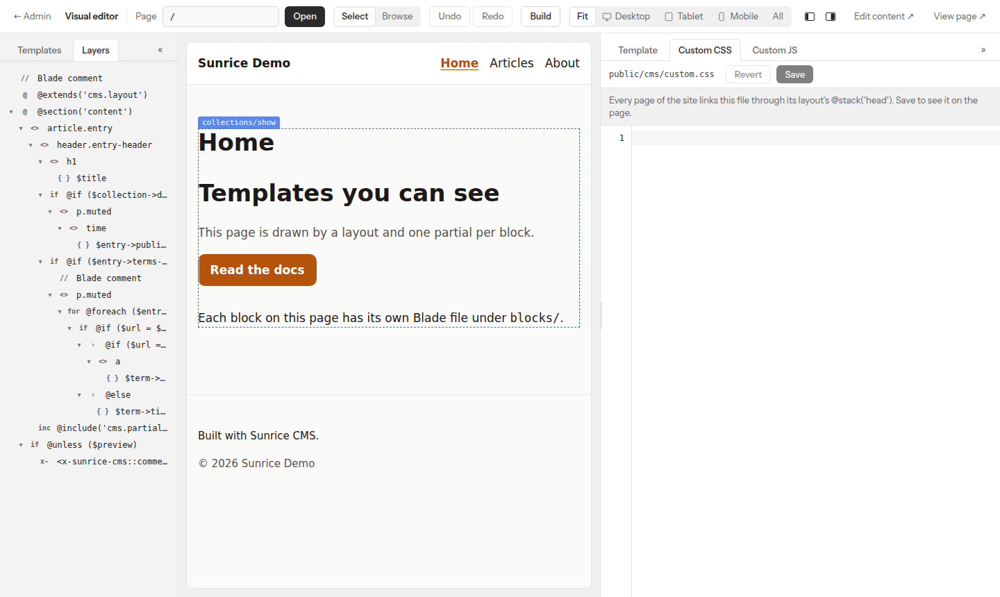
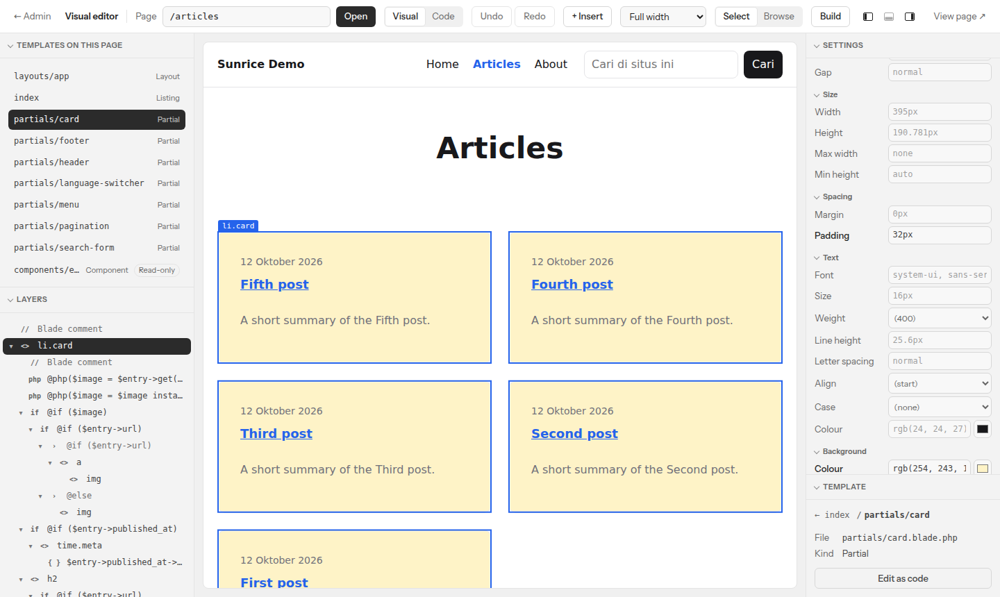

# Sunrice visual editor

A visual template editor for [Sunrice CMS](https://github.com/littleboy130491/sunrice-cms), as a separate package.

It works on the Blade files themselves: no copy of a template in the database
and no second file beside it. A developer can keep editing the same file in a
code editor. The editor reads a Blade file into a tree, changes one thing, and
writes the file back with nothing else disturbed.

What the package will do is in [SPEC.md](SPEC.md); the order of work is in
[EXECUTION_PLAN.md](EXECUTION_PLAN.md).


## What works today

All three milestones of the plan's first part, and styles: the theme's CSS files, changed in place, at every width.

**See a page's templates, click through them, edit them as code.**

- Open any page of the site in the editor. The left panel lists the Blade
  files that draw it: layout, the page's own template, partials, blocks,
  components.
- Point at the page, or at a row, and the part that template draws is
  outlined with its name. Click either to open the template. One click goes
  back to the page's own template.
- **Edit as code** opens the template's source under the page. Saving shows
  the change on the page at once.
- A save is refused, and nothing is written, when the code doesn't compile or
  the file has changed on disk since it was opened. The previous version of
  every saved file is kept in `storage/app/sunrice/template-backups/`.
- Sunrice's own fallback views are shown read-only, with **Copy to site** to
  get a copy the site uses and you can edit.
- Saves appear in the admin's activity log.

**Change a template without touching code.**

- **Layers**: the open template as a tree. Select a node there or by clicking
  it on the page.
- **Settings**, for what is selected: tag, id, classes, attributes, text, what
  an echo prints, a condition, a loop, an include.
- **Insert**: elements, Blade structures, Sunrice's components, the site's
  partials, pasted HTML.
- Move, duplicate, wrap, unwrap and delete, by dragging a layer, by button or
  by key.
- **Undo** and **Redo** for all of it, for as long as the editor is open.
- The page keeps its place after a change: it is drawn again out of sight and
  put in the place of the old one, scrolled to where that was.

**The CMS's fields and variables, picked from a list in place of typed.**

- **Insert → Fields** lists what can be read where the next thing goes: the
  entry of the page with the fields of its collection, a block's fields, the
  item of a loop, what a partial is passed, global sets and menus.
- A click writes the Blade that suits the value: a text printed, rich text
  printed as HTML, an image as an ``, a link as an `<a>`, a list as a
  loop, a yes-or-no as a condition. All of it draws without an error when the
  field is empty, or is not there at all.
- **Use a field…** under a text, an echo or an attribute in Settings fills it
  from a field, and a value that is a field says which.
- A condition is built by choosing a field and what to ask of it ("Price is
  more than 100"); a loop's source is chosen from the lists there are.
- `<x-sunrice::entries>` is set from lists: the collection, the order, how
  many, in pages or not, and filters.

**The CSS for a class, changed where it stands.**



- **Settings → CSS**, for a selected element: the rules of the theme's
  stylesheets (`public/sunrice-theme/*.css`) for one of its classes, a row
  for each declaration. The rule for the class itself first, then the rules
  that only mention it (`.card h2`), and under which `@media` each stands.
- Change a value or a property, add a declaration, take one out: only that
  declaration changes in the file. Its spacing, comments and every other
  rule stay as written. Several declarations can be pasted into the empty
  row as CSS writes them.
- The page shows the change at once, without being drawn again.
- A class without a rule gets one in `public/sunrice-theme/editor.css`, and
  when the page does not link that file yet, one click links it from the
  layout's `<head>`.
- **↶ ↷** beside each stylesheet undo and redo its changes. Each save keeps
  the previous file with the template backups and is in the activity log.
- A value that would break out of its declaration is refused, and nothing is
  written.

**The same rule, as controls.**



- **Settings → Style** has a control for each of the declarations most often
  written: display and the flex and grid settings, width and height, margin
  and padding, font, size, weight, alignment and colour, background, border,
  radius and shadow.
- Each control reads one declaration of the class's own rule and writes one.
  What is typed is CSS (`1rem`, `0 auto`, `var(--accent)`); a colour can be
  picked. Emptying a control takes its declaration out.
- A control the rule says nothing for shows in grey what the page has for it
  from elsewhere, so it is clear what there is to override.
- Both tabs write the same file through the same changes: what one sets, the
  other shows.

**Every width side by side, and a style for one of them.**


- The **width** choice in the top bar shows the page as wide as there is
  room, at one width (Desktop 1280, Tablet 768, Mobile 390), or at all of
  them **side by side**, drawn at one scale. The widths are a setting
  (`widths`).
- Side by side, one frame is the one being edited: it takes the clicks and
  carries the outlines. **Edit here** on another makes that one it, without
  loading a page anew. The others follow every change.
- A style set in the **Style** tab while a width is being edited is written
  for that width: into the class's rule under the `@media` condition of the
  site's own CSS that applies there, or, when the site has none, under the
  one the width is set up with (`(max-width: 640px)` for Mobile). **For**
  at the top of the tab says which, and can be set to another, or to every
  width.
- A rule for a width is put where it counts: after the class's own rule, at
  the end of a `@media` block that is there, else in a new block at the end
  of the file.

**Permissions of its own**: who may open the editor, who may change things,
who may write code (see *Who can use it* below).

Not there yet: tools for AI agents.
A site that builds its CSS (Vite, Tailwind) is styled by its classes: the
editor changes CSS files, not what a build makes of them.

## Using it

The package is not on Packagist yet. To try it, run the demo site from this
repository (`composer serve`, below), or require it from this repository in a
Sunrice site and publish its script:

```bash
php artisan vendor:publish --tag=sunrice-visual-editor-assets
```

**Where it runs.** The editor writes Blade files, which run PHP on the server
and belong in the project's git repository. It is on when `APP_ENV` is `local`
and off otherwise. `SUNRICE_VISUAL_EDITOR=true` turns it on elsewhere, such as
a staging copy; `false` turns it off locally. When it is off, the package adds
no routes and changes nothing about how pages render.

**Who can use it.** Three permissions, given to roles in Sunrice's admin
(Users → Roles, under *Visual editor*). Each includes the ones before it;
Super Admins have all three.

| Permission | Lets someone |
| --- | --- |
| `visual-editor.open` | look: the page, its templates, their layers, their styles |
| `visual-editor.edit` | change templates and stylesheets without writing code: elements, text, classes, fields from the lists, conditions and loops built from choices, CSS |
| `visual-editor.code` | write code: the code panel, and Blade or PHP typed anywhere |

Someone with `edit` and not `code` can't make a template run PHP it did not
run before, whatever they send: every change is compiled by Laravel's own
Blade compiler before it is saved, and refused if the result holds a piece of
PHP that was not there and that the editor did not write itself. They can
rearrange, copy and remove code that is already there, and add any HTML,
scripts included: `edit` is for people you would let change the site's
markup. Run `php artisan sunrice:sync-permissions` after installing, so the
three exist.

**Opening it.** *Visual editor* in the admin's sidebar, under Manage, or
directly:

| Address | Opens |
| --- | --- |
| `/cms/visual-editor` | the homepage |
| `/cms/visual-editor?url=/about` | that page of the site |

`/cms` stands for the site's admin path. The `url` has to be a path on the
site; anything else opens the homepage. A link like the second one can be put
wherever it is handy, for instance in a bookmark for the page being worked on.

## Result of the round-trip test

The approach holds. Full numbers are in [spike/RESULTS.md](spike/RESULTS.md).

| Templates | Files | Open and print back byte for byte | Refused | Edits passed |
| --- | ---: | ---: | ---: | ---: |
| Sunrice starter templates (`stubs/templates`) | 19 | 19 | 0 | 3,695 of 3,695 |
| Sunrice package views (defaults, components, error pages) | 11 | 11 | 0 | 2,031 of 2,031 |
| Laravel framework's own Blade views | 129 | 127 | 2 | 11,733 of 11,733 |
| Edge cases written for this test | 20 | 18 | 2, as intended | 1,132 of 1,132 |

The two Laravel files refused are test fixtures that are malformed on purpose.

In the 19 starter templates, 85% of the 379 nodes are fully visual (elements,
text, conditions, loops, `@switch` arms, includes, plain field echoes,
translation strings), 5% are echoes of a longer PHP expression, 4% are
elements with a directive inside the tag, and 5% are code, mostly `@php`
lines. Code covers 6.5% of the bytes. It was 17% while `@switch` was kept as
code: the form block and the filter form are now edited arm by arm.

## What was tested

For every template:

1. **It opens as a tree and the tree prints back the same bytes.**
   `Template::open()` refuses the file otherwise.
2. **Every kind of edit, on every node it applies to**, each on a fresh tree
   and sent the way the editor sends it, as an operation through `Operations`:
   add and remove a class, add, change and remove an attribute, rename the
   element, retype text, change an echo's expression and escaping, change a
   directive's arguments, rewrite a code node, insert before and after,
   append, delete, duplicate, reorder, move into another element, wrap and
   unwrap.
   An edit passes when the output is exactly the expected bytes, computed
   from the original file and the node's offsets, opens as a tree again, and
   compiles with Laravel's Blade compiler to valid PHP. (For the few edits
   whose new lines depend on the file's indentation, the content must match
   exactly and the layout is covered by unit tests.) Typed text must also
   read back as typed and add nothing for PHP to run.
3. **What the tree can't hold is kept or refused, not damaged.** Tags that
   don't nest stay in the file as written, with the rest still editable (the
   `stray-…` edge fixtures); a file whose Blade can't be read is refused
   (`locked-…`).

## What it showed

- **stillat/blade-parser finds the Blade, not the HTML.** It returns echoes,
  directives, comments, PHP blocks and component tags with positions, pairs
  `@if`/`@else`/`@endif` and component tags, and treats everything else as
  plain text. The HTML layer is written here: `HtmlLexer` and `TreeBuilder`.
- **Its positions count characters, not bytes.** `BladeScanner` converts them;
  the multibyte fixture and the filter form (which contains "—") cover this.
- **It runs without a Laravel application**, through its parser factory hook.
- **Joining two pieces can break a directive.** Deleting the echo in
  `@else{{ $entry->title }}@endif` leaves `@else@endif`, which Blade no longer
  reads as two directives, so the file stops compiling. This turned up in
  `partials/card.blade.php` and two package views. `Seams` now detects it and
  puts one space at the join.
- **Tags that don't nest are kept, not refused.** A tag opened inside one
  `@if` and closed in another, an element left open across `@else`, end tags
  left out (`<li>` without `</li>`), a layout split over a header and a
  footer file. None of the 30 Sunrice templates do this, but hand-written
  Blade often does. The tree keeps each such tag as it is written, marked
  stray: it is shown as code and stays where it is, and everything around it
  is edited as usual (the `stray-…` fixtures). An edit is refused if it would
  leave more of them than there were.
- **What is still refused.** A file whose Blade can't be read into the tree:
  a syntax error, or an `@if` whose `@endif` sits inside a tag (the
  `locked-…` fixtures). Such a file is edited as code.

## The same test for stylesheets

Phase 6 changes CSS files the way the editor changes Blade files: one
declaration, in place. Before building it, the same question was put to CSS.
Full numbers are in [spike/CSS_RESULTS.md](spike/CSS_RESULTS.md).

| Stylesheets | Files | Rules | Declarations | Found in place | Changes passed |
| --- | ---: | ---: | ---: | --- | ---: |
| The starter theme, as written and minified, and edge cases | 6 | 230 | 593 | all | 2,095 of 2,095 |
| normalize.css, Pico, Bulma, Bootstrap, as written and minified | 6 | 10,709 | 24,124 | all | 5,409 of 5,409 |

- **A reader of our own, not a CSS library.** The CSS parser there is for PHP
  wrote none of these files back as it read them, and keeps no positions to
  change a file at. `src/Css/Stylesheet.php` only finds where rules and
  declarations are, and cuts into the text there.
- **Checked against a browser.** Chromium was given the same files: every rule
  it has is one the reader found, in the same order. Of 4,242 changes put to
  it, 4,080 changed exactly the rule that was meant, as meant; the other 162
  changed nothing for it, being of things it does not know (`*zoom`,
  `::-moz-focus-inner`). None changed anything else.
- **A value can't break out.** `red; } body { display: none` is refused, as is
  anything that opens a quote, bracket or comment it doesn't close.
- Only CSS: a Sass or Less source file is not read, and what `@import` brings
  in is not followed.

## Not covered by the round-trip test

- The check is on bytes and on compiling, not on rendered pages. The editor
  render has tests of its own (`tests/Feature/EditorRenderTest.php`).
- The report (`composer spike`) runs without a Laravel application, so it
  leaves component tags (`<x-sunrice::entries>`) as text when compiling. The
  Pest tests run the same edits inside an application, where they compile.
- Edits are checked to be syntactically safe, not meaningful: moving a
  `@php($image = …)` line below the place that uses `$image` still compiles.

## Running it

```bash
composer install
composer test      # Pest: the round-trip checks, the package, a seeded Sunrice site
composer spike     # the round-trip report: adds Laravel's own views, rewrites spike/RESULTS.md
composer spike:css # the same for stylesheets (spike/css-fetch.sh first adds Bootstrap, Bulma, Pico)
composer lint      # Pint
composer analyse   # Larastan

npm install
npm run typecheck
npm run test:frontend
npm run build          # resources/js and resources/css → dist/
npm run test:bridge    # the frame's script in Chrome, against a fixture page
npm run test:css       # the stylesheet reader's rules and changes, put to Chrome
```

`dist/` is committed. On a pull request, CI rebuilds it and commits the
result to the branch, so it doesn't have to be built by hand.

To look at the site the tests use, with the admin at `/cms` (sign in as
`admin@example.com` / `password`) and the editor at `/cms/visual-editor`:

```bash
composer serve     # builds the workbench (assets, templates, database, demo content) and serves it
```

Where Packagist and npm can't be reached but GitHub can, everything above
still runs: the `ci/lock` branch of this repository holds a `composer.lock`
that CI resolved, and a script that fetches each locked package from GitHub
and installs `vendor/` from the copies. Its README says how.

## Layout

```
src/
  Blade/             the template tree
    BladeScanner.php   Blade constructs, from stillat/blade-parser, as atoms with byte offsets
    HtmlLexer.php      tags, comments and doctypes around them, with exact ranges
    TreeBuilder.php    the tree; strict about nesting, throws Unsupported otherwise
    Node.php           a tree node; owns its source text
    Template.php       open(): tree, or Unsupported; version, find(id), toArray()
    Classifier.php     visual / field / label / expression / mixed / code
    Rules.php          what may be done to a node
    TreeData.php       the tree as plain data for the editor's panels
    Edit.php           every edit, in one place
    Operation.php      an edit as plain data: what the editor's screen and AI agents send
    Operations.php     applies operations; hands back a file only if it opens and compiles
    Syntax.php         whether a template compiles
    Variables.php      the variables a template needs to be given
    Attributes.php     edits to an opening tag: attributes, classes, the tag name
    Content.php        edits to text, echoes, directive arguments; a node rewritten as code
    Structure.php      insert, move, duplicate, delete, wrap, unwrap
    Layout.php         the indentation around a node, so new lines match the file
    Fragment.php       a snippet read into nodes
    Inert.php          typed text as text Blade won't run
    Seams.php          keeps directives readable where an edit joins two pieces
  Css/               the theme's stylesheets, read for where things are in them and changed in place
    Stylesheet.php     the rules of a file; a value set, a declaration added or taken out, a rule added
    Rule.php           a rule: its selectors, its declarations, the at-rules it is inside
    Declaration.php    one `property: value`, with the place of each part
    Changes.php        applies changes sent as plain data; all of a list or none
    Selector.php       the selector for a class, and whether a selector mentions it
    ThemeRepository.php  the CSS files in public/sunrice-theme, and the editor's own
    Styles.php         what the stylesheets say about a class, for the CSS tab
  Templates/           the files the editor works with: the site's templates and Sunrice's views
  Insert/              Library: what the editor offers to insert, for this site
  Actions/             SaveTemplate: the only place a template is written; CopyPackageView
  Rendering/           a page rendered for the editor: elements marked with their template
  Http/                the editor's screen, and its API for templates (Controllers/Api)
  Support/             Access: who may use the editor; SunriceBridge: the one file that
                       reads Sunrice's internals (templates, field definitions)
  VisualEditorServiceProvider.php
config/              sunrice-visual-editor.php
routes/admin.php     routes inside the Sunrice admin
resources/js, css/   the editor UI (React from the Sunrice admin), built into dist/:
                       Editor.tsx the screen, panels/ the columns beside the page,
                       canvas/ what is drawn over it, lib/ the API and the frame
resources/js/bridge/ the script in a page shown in the editor's frame, built into dist/bridge.js
spike/               the round-trip reports (templates, stylesheets) and their results
tests/               Pest tests, Frontend/ unit tests and the Browser/ check; fixtures/ holds
                     sunrice-starter and sunrice-package (copied from sunrice-cms at 8c9794e) and edge
workbench/           the Testbench app: user model, migrations, demo content
```
