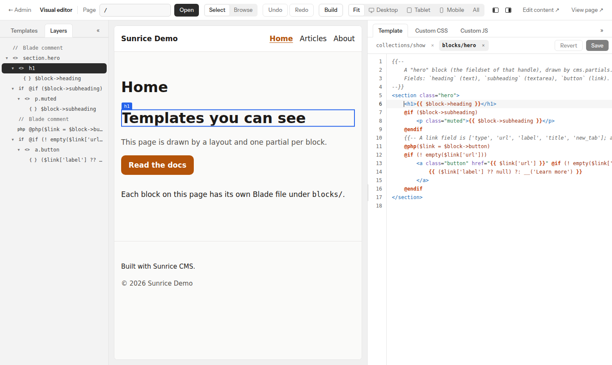
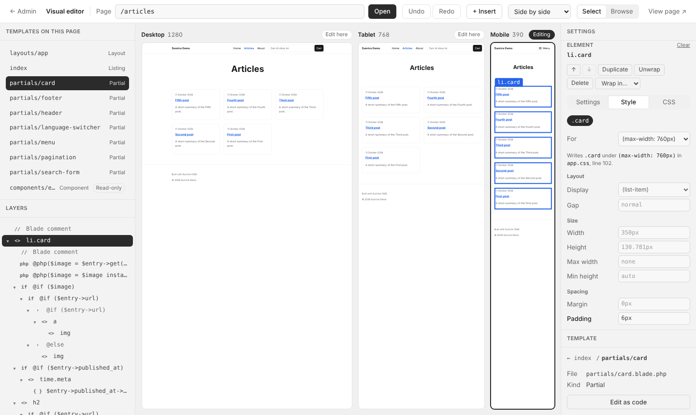

# Sunrice visual editor

A visual template editor for [Sunrice CMS](https://github.com/Digital-Citra-Kreatif/sunrice), as a separate package: a plugin for the Sunrice panel (`sunrice/admin`), beside the CMS (`sunrice/cms`) whose templates it edits.

It works on the Blade files themselves: no copy of a template in the database
and no second file beside it. A developer can keep editing the same file in a
code editor. The editor reads a Blade file into a tree, changes one thing, and
writes the file back with nothing else disturbed.

## Documentation

| | |
| --- | --- |
| [Installation](docs/installation.md) | requiring it, turning it on, settings, updating |
| [How it works](docs/how-it-works.md) | lossless or code, what is checked before a save, how the page knows its templates |
| [Fields and variables](docs/fields.md) | what the code's completions offer at each place, and the Blade they write |
| [Styles](docs/styles.md) | the custom CSS, devices, sites that build their CSS |
| [Permissions](docs/permissions.md) | open, edit, code, build; where the line is and how it is held |
| [AI agents](docs/agents.md) | `visual_editor_get_template_tree` and `visual_editor_edit_template` |
| [Limits](docs/limits.md) | what it does not do |

What the package is meant to do is in [SPEC.md](SPEC.md); how it was built,
task by task, is in [EXECUTION_PLAN.md](EXECUTION_PLAN.md). What each version
brought is in [CHANGELOG.md](CHANGELOG.md).



## What works today

The screen has three parts: on the left the templates of the page and the
open one's layers, a tab each; the page in the middle; on the right the
code and the site's custom CSS and JS. The top bar links to the entry's
content in the admin.

**See a page's templates and click through them.**

- Open any page of the site in the editor. **Templates**, on the left,
  lists the Blade files that draw it (layout, the page's own template,
  partials, blocks, components), and the site's others below.
- **Layers**, the tab beside it, is the open template as a tree, and what
  the left side shows once a template is picked, here or on the page.
  Pointing at a row
  outlines what it draws on the page. A click selects it, scrolls the page
  so the element is in the middle of the frame, and puts the code cursor
  on it.
- In **Select** mode a click on the page opens the template that drew what
  was clicked, selects it in the tree and puts the code cursor, and the
  keyboard, on that element. In **Browse** mode links work as on the site.
- Rows of the tree can be dragged to move what they draw. On a row,
  Alt+Up and Alt+Down move it, Ctrl+D (Cmd+D) duplicates it and Delete
  deletes it.
- **Undo** and **Redo** in the top bar (Ctrl+Z and Ctrl+Shift+Z outside
  the code) cover every change, for as long as the editor is open.
- The page keeps its place after a change: it is drawn again out of sight and
  put in the place of the old one, scrolled to where that was.

**Edit the template as code, beside the page.**

- **Template**, on the right, is the open template's code in a code
  editor: colours for Blade, search and replace, undo of its own.
- Templates open as tabs. What is typed and not saved stays with its tab,
  so the header can be looked at halfway through a change to the page.
- The element the cursor is in is outlined on the page and selected in the
  tree, in text that has been typed in since too.
- Ctrl+S saves, and the page is drawn again. A save is refused, and nothing
  is written, when the code doesn't compile or the file has changed on disk
  since it was opened. The previous version of every saved file is kept in
  `storage/app/sunrice-cms/template-backups/`, beside the CMS's own copies.
- Without the code permission the code can be read and not changed.
- The CMS's own page views (what it draws when the site has no template
  for a page) are shown read-only, with **Copy to site** to get a copy the
  site uses and you can edit.
- Saves appear in the panel's activity log, and the pages the CMS keeps
  for visitors are drawn again.

**The CMS's fields and variables, in the code's completions.**

- While code is typed, the editor offers what a value has: after
  `$values['` the fields of the page, after `$entry->` what every entry
  has, after `{{ ` everything that can be printed.
- **Ctrl+Space** lists everything the template can read where the cursor
  is: the page's `$values` (the fields of its collection, listing page,
  taxonomy…) and its `$entry` or `$term`, a block's fields, the item of a
  loop, `cms_page()`, `$locale`, global sets (`cms_global()`) and menus
  (`cms_menu()`), in the text as typed, saved or not. A word typed first
  narrows it.
- Each is offered in every way it can be written, the usual first: a text
  printed, rich text printed as HTML, an image as an `` or a link to
  the file, a link as an `<a>`, a list as a loop, a yes-or-no as a
  condition. All of it draws without an error when the field is empty, or
  is not there at all; a field only some collections have says so.

**The page's content, a click away.**

- **Edit content ↗** in the top bar opens the CMS's own admin page for the
  entry the page shows, in a tab of its own (the panel is never shown in a
  frame): its fields, validation, drafts, revisions and **Publish** are
  the CMS's. Back in the editor, the page is drawn again.
- The panel's command palette (Cmd/Ctrl+K), on every page of the admin,
  finds the site's pages by title: **Edit About in the visual editor**
  opens the editor on that page.

**A stylesheet and a script of the site's own.**

- **Custom CSS** is one stylesheet, `public/cms/custom.css`, written as
  text and saved with Ctrl+S.
- Every page of the site links it, without a template being changed for
  it: the package adds the link to the layout's `@stack('head')`. The
  deployed site has it too ([Styles](docs/styles.md#custom-css)).
- Each save keeps the previous file with the template backups and is in the
  activity log.
- **Custom JS** is the same for a script, `public/cms/custom.js`, loaded
  (deferred) on every page through the layout's `@stack('head')`. It runs
  in visitors' browsers, so writing it takes `visual-editor.code`
  ([Styles](docs/styles.md#custom-js)).

**Every device side by side.**



- The **device** switch in the top bar shows the page as wide as there is
  room (**Fit**), at one device (Desktop 1280, Tablet 768, Mobile 390), or
  at **All** of them side by side, drawn at one scale. The devices are a
  setting (`widths`).
- Side by side, **Select here** says which frame takes the clicks. Every
  frame is drawn again after a change.

**Room for the page.**

- « folds the tree to a narrow strip at the left edge, and » folds the
  right side to one at the right edge; a click on the strip opens it again.
  The two buttons in the top bar do the same. The page takes the room.
- A line at the right side's edge drags to make the code wider or
  narrower.
- Which sides are folded and how wide the code is are kept in the browser.

**Permissions of its own**: who may open the editor, who may change things,
who may write code ([Permissions](docs/permissions.md)).

**Tools for AI agents**, on the panel's MCP server.

- `visual_editor_get_template_tree` reads a template as the tree the
  editor shows, and `visual_editor_edit_template` changes it by
  operations: add a class, set a text, insert, move, wrap. An agent makes
  a small checked change where the CMS's `cms_write_template` would
  rewrite the whole file.
- Held to what the token's user may do in the editor: changing takes
  `visual-editor.edit`, and Blade or PHP of the agent's own takes
  `visual-editor.code`, by the same check as for a person. Changing also
  takes the site's leave for agents to change templates at all, the CMS's
  `sunrice-cms.ai.templates` (`SUNRICE_AI_TEMPLATES=true`).

A site that builds its CSS (Tailwind through Vite) is styled by its
classes. With `npm run dev` running a class added in the editor shows at
once; otherwise after a build, or before one with the preview turned on
([Styles](docs/styles.md#sites-that-build-their-css)). With a build
command set, **Build** in the top bar runs it for whoever holds
`visual-editor.build`, says **Build needed** once a template has changed,
and shows what the command printed when it fails.

## Using it

The package is not on Packagist yet. To try it, run the demo site from this
repository (`composer serve`, below), or install it in a Sunrice site from
this repository: [Installation](docs/installation.md). It is a plugin of
the panel, added in the app's panel provider after the CMS:
`->plugin(CmsPlugin::make())->plugin(VisualEditorPlugin::make())`.

It is a development tool: on when `APP_ENV` is `local`, off otherwise, and
`SUNRICE_VISUAL_EDITOR=true` turns it on for a staging copy. Who may open
it, change things and write code is decided by three
[permissions](docs/permissions.md) of its own, and who may run the site's
build by a fourth.

**Opening it.** *Visual editor* in the panel's sidebar, under Structure,
**Edit … in the visual editor** in the command palette (Cmd/Ctrl+K), or
directly:

| Address | Opens |
| --- | --- |
| `/admin/visual-editor` | the homepage |
| `/admin/visual-editor?url=/about` | that page of the site |

`/admin` stands for the panel's path. The `url` has to be a path on the
site; anything else opens the homepage. A link like the second one can be put
wherever it is handy, for instance in a bookmark for the page being worked on.

## Result of the round-trip test

The approach holds. Full numbers are in [spike/RESULTS.md](spike/RESULTS.md).

| Templates | Files | Open and print back byte for byte | Refused | Edits passed |
| --- | ---: | ---: | ---: | ---: |
| Sunrice starter templates (`stubs/templates`) | 19 | 19 | 0 | 3,695 of 3,695 |
| Sunrice package views (defaults, components, error pages) | 11 | 11 | 0 | 2,031 of 2,031 |
| Laravel framework's own Blade views | 129 | 127 | 2 | 11,733 of 11,733 |
| Edge cases written for this test | 20 | 18 | 2, as intended | 1,132 of 1,132 |

The two Laravel files refused are test fixtures that are malformed on purpose.

In the 19 starter templates, 85% of the 379 nodes are fully visual (elements,
text, conditions, loops, `@switch` arms, includes, plain field echoes,
translation strings), 5% are echoes of a longer PHP expression, 4% are
elements with a directive inside the tag, and 5% are code, mostly `@php`
lines. Code covers 6.5% of the bytes. It was 17% while `@switch` was kept as
code: the form block and the filter form are now edited arm by arm.

## What was tested

For every template:

1. **It opens as a tree and the tree prints back the same bytes.**
   `Template::open()` refuses the file otherwise.
2. **Every kind of edit, on every node it applies to**, each on a fresh tree
   and sent the way the editor sends it, as an operation through `Operations`:
   add and remove a class, add, change and remove an attribute, rename the
   element, retype text, change an echo's expression and escaping, change a
   directive's arguments, rewrite a code node, insert before and after,
   append, delete, duplicate, reorder, move into another element, wrap and
   unwrap.
   An edit passes when the output is exactly the expected bytes, computed
   from the original file and the node's offsets, opens as a tree again, and
   compiles with Laravel's Blade compiler to valid PHP. (For the few edits
   whose new lines depend on the file's indentation, the content must match
   exactly and the layout is covered by unit tests.) Typed text must also
   read back as typed and add nothing for PHP to run.
3. **What the tree can't hold is kept or refused, not damaged.** Tags that
   don't nest stay in the file as written, with the rest still editable (the
   `stray-…` edge fixtures); a file whose Blade can't be read is refused
   (`locked-…`).

## What it showed

- **stillat/blade-parser finds the Blade, not the HTML.** It returns echoes,
  directives, comments, PHP blocks and component tags with positions, pairs
  `@if`/`@else`/`@endif` and component tags, and treats everything else as
  plain text. The HTML layer is written here: `HtmlLexer` and `TreeBuilder`.
- **Its positions count characters, not bytes.** `BladeScanner` converts them;
  the multibyte fixture and the filter form (which contains "—") cover this.
- **It runs without a Laravel application**, through its parser factory hook.
- **Joining two pieces can break a directive.** Deleting the echo in
  `@else{{ $entry->title }}@endif` leaves `@else@endif`, which Blade no longer
  reads as two directives, so the file stops compiling. This turned up in
  `partials/card.blade.php` and two package views. `Seams` now detects it and
  puts one space at the join.
- **Tags that don't nest are kept, not refused.** A tag opened inside one
  `@if` and closed in another, an element left open across `@else`, end tags
  left out (`<li>` without `</li>`), a layout split over a header and a
  footer file. None of the 30 Sunrice templates do this, but hand-written
  Blade often does. The tree keeps each such tag as it is written, marked
  stray: it is shown as code and stays where it is, and everything around it
  is edited as usual (the `stray-…` fixtures). An edit is refused if it would
  leave more of them than there were.
- **What is still refused.** A file whose Blade can't be read into the tree:
  a syntax error, or an `@if` whose `@endif` sits inside a tag (the
  `locked-…` fixtures). Such a file is edited as code.

## The same test for stylesheets

Phase 6 changes CSS files the way the editor changes Blade files: one
declaration, in place. Before building it, the same question was put to CSS.
Full numbers are in [spike/CSS_RESULTS.md](spike/CSS_RESULTS.md).

| Stylesheets | Files | Rules | Declarations | Found in place | Changes passed |
| --- | ---: | ---: | ---: | --- | ---: |
| The starter theme, as written and minified, and edge cases | 6 | 230 | 593 | all | 2,095 of 2,095 |
| normalize.css, Pico, Bulma, Bootstrap, as written and minified | 6 | 10,709 | 24,124 | all | 5,409 of 5,409 |

- **A reader of our own, not a CSS library.** The CSS parser there is for PHP
  wrote none of these files back as it read them, and keeps no positions to
  change a file at. `src/Css/Stylesheet.php` only finds where rules and
  declarations are, and cuts into the text there.
- **Checked against a browser.** Chromium was given the same files: every rule
  it has is one the reader found, in the same order. Of 4,242 changes put to
  it, 4,080 changed exactly the rule that was meant, as meant; the other 162
  changed nothing for it, being of things it does not know (`*zoom`,
  `::-moz-focus-inner`). None changed anything else.
- **A value can't break out.** `red; } body { display: none` is refused, as is
  anything that opens a quote, bracket or comment it doesn't close.
- Only CSS: a Sass or Less source file is not read, and what `@import` brings
  in is not followed.

## Not covered by the round-trip test

- The check is on bytes and on compiling, not on rendered pages. The editor
  render has tests of its own (`tests/Feature/EditorRenderTest.php`).
- The report (`composer spike`) runs without a Laravel application, so it
  leaves component tags (`<x-sunrice-cms::entries>`) as text when compiling. The
  Pest tests run the same edits inside an application, where they compile.
- Edits are checked to be syntactically safe, not meaningful: moving a
  `@php($image = …)` line below the place that uses `$image` still compiles.

## Running it

```bash
composer install
composer test      # Pest: the round-trip checks, the package, a seeded Sunrice site (the panel and the CMS)
composer spike     # the round-trip report: adds Laravel's own views, rewrites spike/RESULTS.md
composer spike:css # the same for stylesheets (spike/css-fetch.sh first adds Bootstrap, Bulma, Pico)
composer lint      # Pint
composer analyse   # Larastan

npm install
npm run typecheck
npm run test:frontend
npm run build          # resources/js and resources/css → dist/
npm run test:bridge    # the frame's script in Chrome, against a fixture page
npm run test:css       # the stylesheet reader's rules and changes, put to Chrome
```

`dist/` is committed. On a pull request, CI rebuilds it and commits the
result to the branch, so it doesn't have to be built by hand.

To look at the site the tests use, with the panel at `/admin` (sign in as
`admin@example.com` / `Sunrice-Demo-2026!`) and the editor at `/admin/visual-editor`:

```bash
composer serve     # builds the workbench (assets, templates, database, demo content) and serves it
```

To try the installation page on a new Laravel application (it makes one in
a temporary directory, installs the Sunrice panel and CMS and this checkout
into it, checks the site as installed and removes the package again):

```bash
.github/install-check.sh
```

The same on a site whose CSS is Tailwind built by Vite (it needs Node and
npm, and Chrome for its last part): a class added in the editor reaches the
CSS by a build, run by hand and from the editor's Build button, and by the
dev server, and the editor is tried in a browser with the dev server
running.

```bash
.github/vite-check.sh
```

Where Packagist and npm can't be reached but GitHub can, everything above
still runs: the `ci/lock` branch of this repository holds a `composer.lock`
that CI resolved, and a script that fetches each locked package from GitHub
and installs `vendor/` from the copies. Its README says how.

## Layout

```
src/
  Blade/             the template tree
    BladeScanner.php   Blade constructs, from stillat/blade-parser, as atoms with byte offsets
    HtmlLexer.php      tags, comments and doctypes around them, with exact ranges
    TreeBuilder.php    the tree; strict about nesting, throws Unsupported otherwise
    Node.php           a tree node; owns its source text
    Template.php       open(): tree, or Unsupported; version, find(id), toArray()
    Classifier.php     visual / field / label / expression / mixed / code
    Rules.php          what may be done to a node
    TreeData.php       the tree as plain data for the editor's panels
    Edit.php           every edit, in one place
    Operation.php      an edit as plain data: what the editor's screen and AI agents send
    Operations.php     applies operations; hands back a file only if it opens and compiles
    Syntax.php         whether a template compiles
    Variables.php      the variables a template needs to be given
    Attributes.php     edits to an opening tag: attributes, classes, the tag name
    Content.php        edits to text, echoes, directive arguments; a node rewritten as code
    Structure.php      insert, move, duplicate, delete, wrap, unwrap
    Layout.php         the indentation around a node, so new lines match the file
    Fragment.php       a snippet read into nodes
    Inert.php          typed text as text Blade won't run
    Seams.php          keeps directives readable where an edit joins two pieces
  Css/               the theme's stylesheets, read for where things are in them and changed in place
    Stylesheet.php     the rules of a file; a value set, a declaration added or taken out, a rule added
    Rule.php           a rule: its selectors, its declarations, the at-rules it is inside
    Declaration.php    one `property: value`, with the place of each part
    Changes.php        applies changes sent as plain data; all of a list or none
    Selector.php       the selector for a class, and whether a selector mentions it
    ThemeRepository.php  the CSS files in public/cms, the editor's own and the custom CSS
    Styles.php         what the stylesheets say about a class
  Guard/               what someone who may not edit code can't get into a template (CodeGuard)
  Mcp/                 the tools for AI agents: visual_editor_get_template_tree, visual_editor_edit_template
  Templates/           the files the editor works with: the site's templates and the CMS's views
  Insert/              Library: what can be inserted, for this site (the API and AI agents)
  Actions/             SaveTemplate: the only place a template is written; CopyPackageView
  Rendering/           a page rendered for the editor: elements marked with their template;
                       CustomCss, CustomJs: the custom CSS and JS on every page
  Http/                the editor's screen, and its API for templates (Controllers/Api)
  Support/             Access: who may use the editor; SunriceBridge: the one file that
                       reads the CMS (templates, which page uses which, field definitions)
  VisualEditorPlugin.php           what it adds to the panel: permissions, routes, its page, tools
  VisualEditorServiceProvider.php  its config, published files, and what it adds to the site's pages
config/              sunrice-visual-editor.php
routes/admin.php     routes inside the panel
resources/js, css/   the editor UI (the panel's React and Inertia, window.Sunrice.modules), built into dist/:
                       Editor.tsx the screen, panels/ the tree and the tabs beside the page,
                       canvas/ what is drawn over it, lib/ the API and the frame
resources/js/bridge/ the script in a page shown in the editor's frame, built into dist/bridge.js
resources/js/code/   the code editor (CodeMirror), built into dist/code-editor.js and fetched when code is first shown
spike/               the round-trip reports (templates, stylesheets) and their results
tests/               Pest tests, Frontend/ unit tests and the Browser/ check; fixtures/ holds
                     site/ (the demo site's block templates), sunrice-starter and sunrice-package
                     (Blade of Sunrice before 0.1, kept for the round-trip tests) and edge
workbench/           the Testbench app: user model, panel provider, migrations, demo content
```
